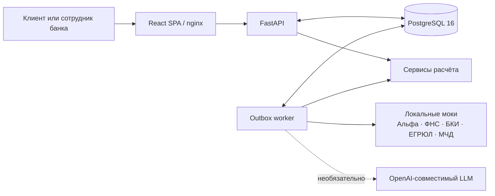

# Умный кредитный кабинет предпринимателя

Прототип цифрового кредитного конвейера для малого бизнеса. Клиент видит прогноз движения денег, получает предложение, оформляет заявку и следит за решением. Сотрудник банка работает с той же заявкой: проверяет данные, запрашивает документы, принимает решение и передаёт крупные суммы риск-менеджеру.

Проект сделан для кейса «Умный кредитный кабинет предпринимателя» хакатона «Альфа-Будущее». Все люди, компании, операции и документы в демо вымышлены.

## Что можно проверить

- путь клиента от потребности в деньгах до подписания и симулированной выдачи;
- автоматическое решение, ручную проверку, контрпредложение и отказ;
- объяснение суммы и ставки без показа клиенту внутренних баллов;
- загрузку выписки 1С из другого банка и пересчёт лимита;
- работу бухгалтера по МЧД, андеррайтера, риск-менеджера и администратора правил;
- прогноз кассового разрыва, сезонный график, чат, уведомления и документы;
- версии правил и прогон изменений на синтетических клиентах до публикации.

Главный демонстрационный сценарий — кофейня ИП Иванова, логин `p3b`.

## Быстрый запуск

### Требования

| Что нужно | Требование |
| --- | --- |
| Docker | Docker Desktop или Docker Engine с Compose v2 |
| Память | Не менее 8 ГБ, рекомендуется 12 ГБ |
| GPU | Не нужен |
| Свободные порты | `8080`, `8000`, `8100` |
| Интернет | Нужен при первой сборке для загрузки образов и зависимостей |

На macOS лучше использовать путь из латинских символов. В некоторых версиях Docker Desktop BuildKit падает, если в полном пути есть кириллица. Обычная папка после клонирования репозитория подходит.

```bash
git clone https://github.com/Spitsin16/Creatots_Alfa_Hack.git
cd Creatots_Alfa_Hack
docker compose up --build
```

Первая сборка занимает несколько минут. Когда сервисы запустятся:

| Сервис | Адрес |
| --- | --- |
| Кабинет клиента и банка | http://localhost:8080 |
| API и Swagger | http://localhost:8000/docs |
| Моки внешних систем | http://localhost:8100/docs |

### Материалы API

- интерактивный Swagger запущенного стенда: http://localhost:8000/docs;
- статическая схема: [docs/openapi.json](docs/openapi.json);
- Postman-коллекция: [docs/postman/Smart_Credit_Cabinet.postman_collection.json](docs/postman/Smart_Credit_Cabinet.postman_collection.json).

Импортируйте коллекцию в Postman и запускайте запросы внутри выбранного сценария сверху вниз. Переменная `baseUrl` уже настроена на `http://localhost:8000`; токены, идентификаторы бизнеса, предложения, заявки и согласования сохраняются автоматически. Для полного прогона лучше начать с чистой базы. В запросе загрузки выписки нужно выбрать локальный файл `data/statements/p3b_other_bank_1c.txt`.

Если API изменился, материалы можно пересобрать из корня репозитория:

```bash
python tools/export_api_materials.py
```

Остановить проект:

```bash
docker compose down
```

Удалить демо-заявки и начать с чистой базы:

```bash
docker compose down -v
docker compose up --build
```

## Проверка основного сценария

После чистого запуска весь путь занимает около пяти минут.

1. Откройте http://localhost:8080 и нажмите **«Начать с главного сценария»**.
2. На главной странице посмотрите прогноз: 12 ноября кофейне не хватает денег на регулярные платежи.
3. Выберите цель **«Закрыть кассовый разрыв»**, сумму `340 000 ₽` и срок `12 месяцев`.
4. Дайте согласие на запрос данных в БКИ и ФНС и нажмите **«Рассчитать предложение»**.
5. Кабинет предложит овердрафт с лимитом `270 000 ₽` и объяснит, чем ограничена сумма.
6. Загрузите файл `data/statements/p3b_other_bank_1c.txt`. После учёта оборотов в другом банке лимит станет `360 000 ₽`.
7. Выберите сумму `360 000 ₽`, оформите и отправьте заявку. Автоматический конвейер переведёт её в статус **«Одобрено»**.
8. Введите код `0000` и подпишите договор.
9. После симулированной выдачи появятся статус **«Деньги на счёте»**, договор и раздел **«Мой кредит»**.

Слева внизу находится переключатель **«Кабинеты демо»**. Через него можно открыть кабинет андеррайтера, риск-менеджера или администратора правил. Справа находится панель **«Демо-сценарий»** с подсказками по текущему шагу.

### Другие сценарии

| Логин | Что показывает |
| --- | --- |
| `p1a` | Автоматическое одобрение оборотного кредита |
| `p1b` | Контрпредложение и рефинансирование кредита другого банка |
| `p2a` | Возвращение клиента с хорошей историей в Альфе |
| `p2b` | Ручная проверка, запрос документов и чат |
| `p3a_acc` → `p3a` | Бухгалтер готовит заявку, директор отправляет и подписывает |
| `p3a` → `uw1` → `risk1` | Сумма выше 5 млн ₽ и второе одобрение |
| `p_stop` | Отказ из-за действующей просрочки с объяснением дальнейших действий |
| `admin1` | Редактор и версии правил, сравнение «было / стало» |

Пароль для всех демо-учёток — `demo`. Код подписания — `0000`.

На экране входа также есть песочница: можно задать обороты, кредитную нагрузку и историю собственного синтетического клиента. Решение рассчитывается тем же движком, что и для готовых профилей.

## Архитектура



| Компонент | Назначение |
| --- | --- |
| `frontend/` | React-интерфейс клиента и банка, маршруты, запросы и браузерные тесты |
| `backend/app/api/` | Авторизация, предложения, заявки, документы, чат, банк и правила |
| `backend/app/services/` | Скоринг, прогноз, выписка 1С, объяснения и внешние интеграции |
| `backend/app/worker.py` | Фоновая обработка событий из таблицы `outbox` |
| `mocks/` | Локальные ответы Альфы, ФНС, БКИ, реестра и МЧД, включая симуляцию сбоев |
| `data/` | Правила, синтетические персоны, эталон расчёта и демо-выписка |

Основной API публикует OpenAPI и Swagger на `/docs`. Подробное описание компонентов находится в [docs/ARCHITECTURE.md](docs/ARCHITECTURE.md), модель данных и ER-диаграмма — в [docs/DATA_MODEL.md](docs/DATA_MODEL.md), статусы заявки — в [docs/STATES.md](docs/STATES.md), правила решения — в [docs/DECISION_RULES.md](docs/DECISION_RULES.md), допущения — в [docs/ASSUMPTIONS.md](docs/ASSUMPTIONS.md).

### Как принимается решение

Скоринг и кредитное решение разделены. Детерминированный движок читает активную версию `rules.yaml`, рассчитывает риск, лимит, ставку и дальнейший маршрут. Правила хранятся в БД, а каждое решение содержит номер использованной версии.

LLM не участвует в расчёте. Если его подключить, он только формулирует текст по готовым фактам. При ошибке, таймауте или появлении посторонних чисел система использует шаблон.

## Конфигурация

Для стандартного демо создавать `.env` не нужно: у Compose есть локальные значения по умолчанию.

| Переменная | По умолчанию | Назначение |
| --- | --- | --- |
| `DATABASE_URL` | PostgreSQL из Docker Compose | Подключение к основной БД |
| `JWT_SECRET` | `local-demo-secret-change-me` | Подпись демо-токенов; для внешнего стенда значение нужно заменить |
| `DEMO_SIGN_CODE` | `0000` | Код симулированного подписания |
| `DEMO_TODAY` | `2026-10-22` | Фиксированная дата для воспроизводимого прогноза |
| `LLM_BASE_URL` | пусто | Адрес необязательного OpenAI-совместимого API |
| `LLM_API_KEY` | пусто | Ключ необязательного LLM API |
| `LLM_MODEL` | пусто | Название модели |

Пример настроек находится в [.env.example](.env.example).

### Необязательная локальная модель

Без LLM все основные функции работают на шаблонах. Для демонстрации с открытой моделью Qwen через Ollama понадобится около 5 ГБ дополнительного места:

```bash
LLM_BASE_URL=http://ollama:11434/v1 \
LLM_MODEL=qwen2.5:7b-instruct-q4_K_M \
docker compose --profile llm up --build
```

## Проверки

На каждый push и pull request GitHub Actions запускает:

- Ruff и backend-тесты на PostgreSQL 16;
- сравнение скоринга всех персон с `data/reference/expected.json`;
- TypeScript и production-сборку фронта;
- сборку Docker Compose с нуля;
- Playwright: путь `p3b` до выдачи, вход андеррайтера и отказ `p_stop`;
- повторный запуск API с проверкой сохранности данных.

Локальный браузерный прогон при запущенном стенде:

```bash
cd frontend
npm ci
npx playwright install chromium
npm run e2e
```

Backend без Docker:

```bash
python3 -m venv .venv
source .venv/bin/activate
python -m pip install -r backend/requirements.lock
cd backend
ruff check .
python -m pytest -q
```

Нагрузочный smoke-тест:

```bash
python tools/loadtest.py --base http://localhost:8080 --users 20 --seconds 60
```

## Ограничения демо

- используются только синтетические данные;
- внешние системы заменены локальными моками;
- выдача денег и SMS симулируются;
- договор помечен «ДЕМО» и не имеет юридической силы;
- авторизация упрощена до тестовых учёток;
- LLM необязателен и не принимает кредитных решений;
- без удаления Docker volume предыдущие демо-заявки сохраняются между запусками.

Сторонние библиотеки, контейнеры и модель перечислены в [THIRD_PARTY_NOTICES](THIRD_PARTY_NOTICES).
