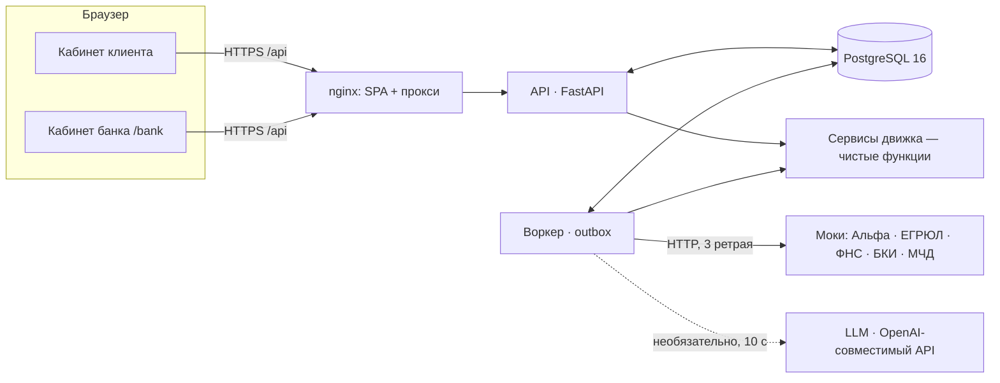

# Архитектура

| Компонент | Где | Что делает |
| --- | --- | --- |
| Фронт | `frontend/` (React + TS + Vite, nginx) | Анкета, предложение, выписка, прогноз, сезонный график, трекер, чат, уведомления; банк — очередь, карточка, действия, риск, правила |
| API | `backend/app/api/` | Вход, профиль, согласия, предрасчёт, заявки, подпись; `insights` — объяснение, выписка, график, прогноз; `chat` — чат и уведомления; `documents` — хранилище и документы по заявке; `client_actions` — контрпредложение, отмена, «перемотать время»; `assistant` — ассистент; `bank` — очередь и решения; `rules_admin` — версии правил |
| Воркер | `backend/app/worker.py` | Забирает события из `outbox` (`APPLICATION_SUBMITTED`, `CONTRACT_SIGNED`, `EXPLAIN_PRE_OFFER`), опрашивает источники, ставит статусы; раз в минуту возвращает просроченные назначения в очередь |
| Сервисы движка | `backend/app/services/` | `scoring` (решение, симуляция правил), `statement_1c`, `explain` (шаблоны, LLM, проверка чисел), `seasonal`, `forecast`, `integrations` (клиент моков), `notifications` (уведомления, SLA), `documents`, `assistant`, `sla_sweep`, `expiry` |
| Моки | `mocks/` | Данные внешних систем по ИНН из `data/personas`, сбои `?fail=timeout|500` и `POST /_faults` |
| Данные | `data/` | `rules.yaml`, 7 персон, выписка 1С, эталонный движок и `expected.json` |

## Принципы

- **Решение — правила, не модель.** Правила версионируются в БД, решение хранит `rules_version`. LLM только переформулирует готовые факты; числа в её ответе сверяются с входом, иначе шаблон.
- **Статусы — только через граф** (`app/states.py`): недопустимый переход → 409, каждый переход пишется в `status_history` в той же транзакции.
- **Фоновые шаги — через outbox.** API отвечает сразу, воркер доделывает; падение источника или LLM не теряет заявку. Отправка и подпись идемпотентны.
- **Деньги — целые копейки**, ставки — `numeric(5,2)`, время — `timestamptz`, «сегодня» — `DEMO_TODAY`.
- **Клиенту — без внутренностей.** Баллы, класс, пороги и антифрод видит только банк; это проверяют тесты.
- **Аудит.** Решения, назначения, правила, источники, SMS-заглушка, чат — в `audit_log`; журнал доступен в кабинете банка.

## Данные

Основные таблицы: `users`, `businesses`, `memberships` (права по МЧД), `consents`, `data_snapshots`, `statements`, `rules`, `pre_offers`, `applications`, `status_history`, `decisions`, `approvals`, `contracts`, `documents`, `files`, `messages`, `notifications`, `audit_log`, `outbox`. Миграции — `backend/alembic/versions/`.

## Проверки

- `pytest`: эталон по 7 персонам, API, банк, чат, уведомления, выписка, правила, LLM-фолбэк, SLA.
- CI: Ruff, pytest на PostgreSQL 16, сверка эталона, сборка фронта, `docker compose up` с нуля и смоук-тест.
- `tools/loadtest.py` — нагрузочный прогон.
