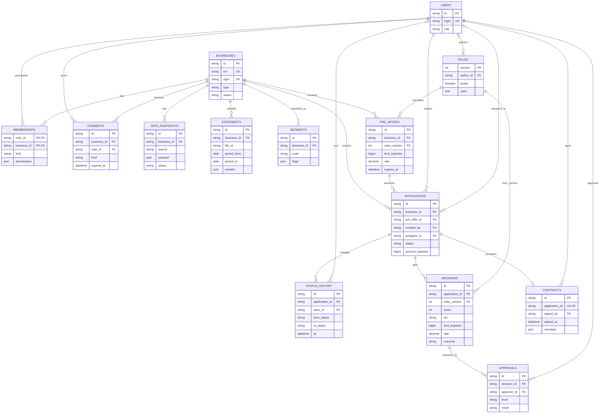
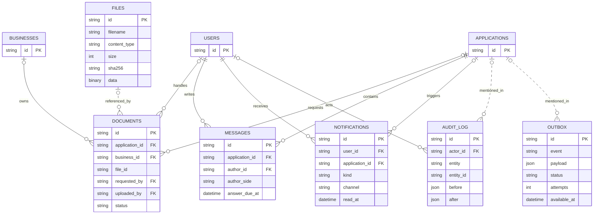

# Модель данных

Документ описывает фактическую модель демо-стенда. Источники правды — SQLAlchemy-модели в `backend/app/models/__init__.py` и миграции Alembic в `backend/alembic/versions/`.

Основная БД — PostgreSQL 16. SQLite поддерживается только для быстрой локальной разработки и части тестов.

## Основной кредитный процесс



Главная цепочка данных: компания и пользователь дают согласия, система получает снимки источников и определяет сегмент, затем по версии правил создаёт предварительное предложение. Из предложения появляется заявка; все её переходы сохраняются в истории. Решение навсегда связано с использованной версией правил. Для крупных сумм к решению добавляются два уровня согласования, после одобрения создаётся один договор.

## Документы, общение и фоновые задачи



Пунктиром показаны логические связи без внешнего ключа. `documents.file_id` указывает на запись в `files`; `statements.file_id` хранит идентификатор загрузки выписки, но сам разобранный файл не связан с `files`. Поля `audit_log.entity_id` и идентификаторы внутри `outbox.payload` полиморфны. Целостность этих ссылок контролирует прикладной код.

## Назначение таблиц

| Таблица | Что хранит |
| --- | --- |
| `users` | Демо-пользователей и банковские роли. |
| `businesses` | ИП и ООО, их реквизиты и состояние регистрации. |
| `memberships` | Связь пользователя с бизнесом, вид полномочий и права МЧД. |
| `consents` | Согласия на запрос данных БКИ и ФНС со сроком действия. |
| `data_snapshots` | Неизменяемые снимки ответов Альфы, ФНС, БКИ, реестра и МЧД. |
| `statements` | Результат разбора выписки 1С по месяцам и ошибки проверки. |
| `segments` | Результаты сегментации компании и признаки, повлиявшие на сегмент. |
| `rules` | Версии YAML-правил; активная версия используется для новых расчётов. |
| `pre_offers` | Предварительный расчёт: продукт, срок, лимит, ставка, платёж и объяснение. |
| `applications` | Заявку, текущий статус, сумму, продукт, автора и назначенного сотрудника. |
| `status_history` | Полную историю переходов заявки с автором, временем и комментарием. |
| `decisions` | Внутренний результат скоринга, факторы, лимит, ставку, исход и версию правил. |
| `approvals` | Решения андеррайтера и риск-менеджера с обязательным комментарием. |
| `contracts` | Единственный подписанный договор по заявке и график платежей. |
| `files` | Бинарное содержимое файлов демо-стенда, метаданные и SHA-256. |
| `documents` | Документы бизнеса и документы, запрошенные в рамках заявки. |
| `messages` | Чат по заявке и контроль четырёх рабочих часов на ответ банка. |
| `notifications` | Внутренние уведомления и SMS-заглушки, связанные с пользователем и заявкой. |
| `audit_log` | Журнал действий с состоянием до и после изменения. |
| `outbox` | Очередь фоновых событий с числом попыток и временем следующей обработки. |

## Правила хранения

- Идентификаторы сущностей — UUID в строковом формате длиной 36 символов.
- Денежные значения хранятся целым числом копеек в `bigint`: например, `36 000 000` означает `360 000 ₽`.
- Ставки хранятся как `numeric(5,2)`, без вычислений через `float`.
- Временные отметки используют `timestamptz`; дата демо задаётся переменной `DEMO_TODAY`.
- Структурированные снимки, факторы, объяснения и графики хранятся в JSONB на PostgreSQL.
- `decisions.rules_version` фиксирует версию правил, поэтому публикация новых правил не меняет старые решения.
- Текущий статус находится в `applications.status`, а каждый переход добавляется в `status_history` в той же транзакции.
- Клиентский API не выдаёт `score`, класс риска, антифрод-признаки и внутренние пороги из `decisions`.
- `outbox` отделяет запись бизнес-события от фоновой обработки и позволяет повторять временно неудачные операции.

## Миграции и проверка

Схема создаётся последовательностью миграций Alembic:

1. `012d82640aae_initial_credit_schema.py` — основной кредитный процесс;
2. `7c1e5a2b9d40_chat_and_notifications.py` — чат и уведомления;
3. `9d2f4b7c1a3e_document_storage.py` — файлы и хранилище документов.

Применить миграции к указанной в `DATABASE_URL` базе:

```bash
cd backend
alembic upgrade head
```

Состояния и допустимые переходы описаны в [STATES.md](STATES.md), правила решения — в [DECISION_RULES.md](DECISION_RULES.md), границы компонентов — в [ARCHITECTURE.md](ARCHITECTURE.md).
