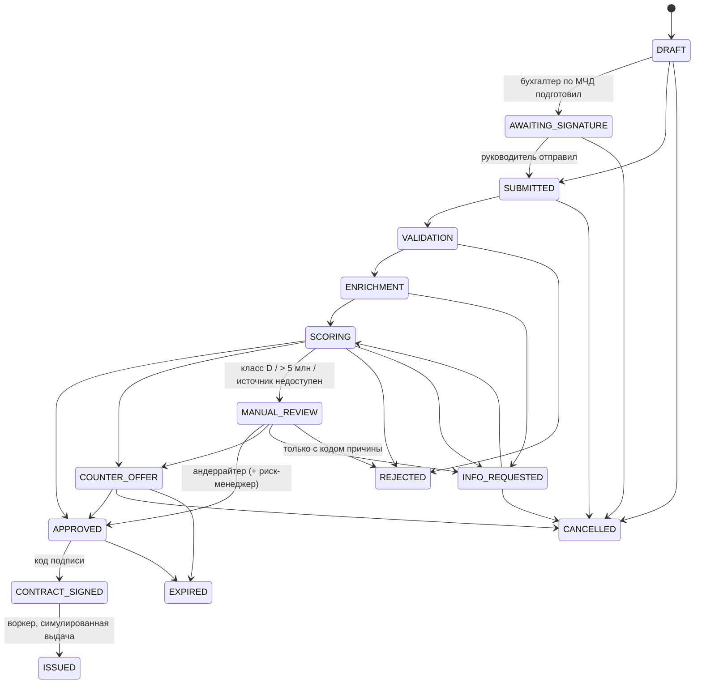

# Статусы заявки

Граф — `backend/app/states.py`, переход — `services/application_flow.transition_application`:
недопустимый переход → HTTP 409; каждый переход пишется в `status_history` в той же транзакции,
что и смена статуса; клиент получает уведомление о значимых статусах.

| Статус | Кто переводит | Клиент видит | Уведомление (SMS-заглушка) |
| --- | --- | --- | --- |
| `DRAFT` | клиент / бухгалтер | Черновик | — |
| `AWAITING_SIGNATURE` | бухгалтер по МЧД | Ждёт отправки руководителем | в кабинете |
| `SUBMITTED` | клиент (идемпотентно) | Отправлена | в кабинете |
| `VALIDATION`, `ENRICHMENT`, `SCORING` | воркер | Проверяем / собираем данные / рассчитываем | — (технические этапы) |
| `MANUAL_REVIEW` | воркер | Проверяет специалист, срок — рабочий день | в кабинете |
| `INFO_REQUESTED` | андеррайтер | Нужны документы | в кабинете + SMS |
| `APPROVED` | воркер / андеррайтер + риск | Одобрено, подпишите | в кабинете + SMS |
| `COUNTER_OFFER` | воркер / андеррайтер | Предложение банка | в кабинете + SMS |
| `REJECTED` | воркер / андеррайтер | Причина и что поможет | в кабинете + SMS |
| `CONTRACT_SIGNED` | клиент (код) | Договор подписан | — |
| `ISSUED` | воркер | Деньги на счёте | в кабинете + SMS |
| `CANCELLED`, `EXPIRED` | клиент / система | Закрыта | в кабинете (`CANCELLED`) |
