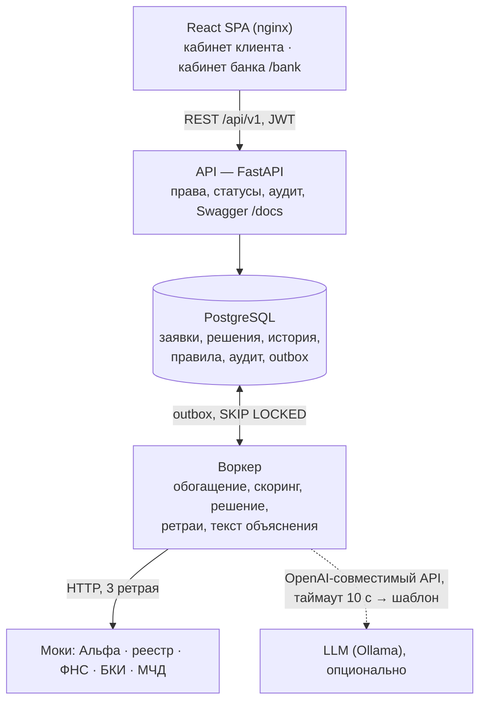

# ТЗ: умный кредитный кабинет МСБ — MVP

Версия 22.10.2026 · источник: документ ТЗ в Claude (эта копия — для агентов и команды; при расхождении верна последняя версия в репозитории)

## 1. Цель и объём MVP

Строим работающий кредитный конвейер для **действующих клиентов Альфы** — ИП и ООО: клиент отвечает на короткую анкету, получает предложение с объяснением, подаёт заявку, видит статус, подписывает кодом и получает деньги (выдача симулируется); банк обрабатывает заявку по этапам и ролям. Отличие от рынка — не «да/нет», а объяснение «почему такая сумма» и маршрут «как получить больше».

Принятые решения (20.10):

| Вопрос | Решение |
| --- | --- |
| Сегменты | Действующие клиенты Альфы, сегменты 1А–3Б (6 из 11; остальные — развитие). Сегмент определяет система по данным, клиент отвечает только «бизнес зарегистрирован?» |
| Интерфейс | Одна адаптивная заявка и 4 потока экранов, а не 11 отдельных путей |
| Продукты | Овердрафт, оборотный кредит, кредитная линия, рефинансирование |
| Кабинет банка | Роли андеррайтер, риск-менеджер, админ правил |
| LLM | Тексты объяснений по факторам и ассистент (раздел 16); при недоступности — шаблон |
| Стек | React + FastAPI + PostgreSQL, всё в Docker |

Не делаем: гарантии, бизнес-ипотеку, реальную регистрацию ИП и открытие счёта (для 0А/0Б и 5 — экраны с маршрутом), уведомления по почте и SMS (кейс требует, чтобы основной сценарий шёл внутри продукта).

Порядок готовности: сначала сквозной путь 3Б и 1А до выдачи, затем остальные сегменты. Если что-то не успеваем, демо всё равно работает.

### 1.1. Уточнения 21–22.10 (имеют приоритет)

По ответам организаторов (Q&A, 75 вопросов) и решениям команды:

- **Только действующие клиенты Альфы** (Q&A 3, 9). Сегменты 0, 4, 5, вход через Госуслуги и проверки адреса новых клиентов уходят в «Развитие».
- **Одно веб-приложение с двумя ролями** (17, 55); десктоп обязателен, мобильная версия — небольшой плюс (14).
- **Демо заканчивается выдачей**: принятие предложения и симулированная выдача (7). Сопровождение после выдачи не обязательно (1).
- **ИИ сам по себе баллов не даёт** (19, 47); ассистент необязателен (26) — режем первым. LLM — только через OpenAI-совместимый API с настраиваемыми base URL, токеном и моделью (20, 68); закрытый OCR запрещён (24).
- **Железо проверяющих**: сервер \~12 ГБ, клиент 8 ГБ, без GPU, интернет есть (41, 45, 56). Режим без LLM — основной. Модель можно качать при первом запуске с указанием источника (57) и запускать вне Docker (39).
- **Продукты и условия можно свои**, но рыночные с учётом ключевой ставки (34, 35).
- **Связь с сотрудником — чат в кабинете, звонков нет.** SMS — только заглушка-канал с записью в журнал: основной сценарий идёт внутри продукта, платные шлюзы запрещены.
- **В репозитории обязателен `docs/ASSUMPTIONS.md`** — все упрощения с объяснением (11, 33, 49, 60), и `docs/RESEARCH.md` — разбор 94 отзывов и какие решения он изменил (48).
- **Данные и правила готовы:** пакет `alfa-credit-data` (rules.yaml, 7 персон, выписка 1С, эталонный движок и expected.json). Правила в разделе 7 — описание, источник правды — rules.yaml.

## 2. Архитектура и стек

Шесть сервисов в одном `docker-compose.yml`: фронт, API, воркер, PostgreSQL, моки и LLM (отдельный профиль). Альфа, реестры, ФНС, БКИ и МЧД — моки, доступа к системам Альфы нет.



API принимает запрос, меняет статус и кладёт задачу в outbox одной транзакцией. Воркер забирает задачу, ходит в моки и LLM и двигает заявку дальше — поэтому сбой внешней системы не теряет заявку.

| Слой | Технологии |
| --- | --- |
| Фронт | React + TypeScript, Vite, React Router, TanStack Query; клиент API генерируется из OpenAPI |
| Бэк | Python 3.12, FastAPI, SQLAlchemy 2, Alembic, Pydantic 2, httpx |
| Воркер | тот же код бэка, отдельный процесс, задачи из таблицы outbox |
| База | PostgreSQL 16 |
| LLM | Ollama + Qwen2.5-7B-Instruct |
| Тесты | pytest (скоринг, статусы, разбор выписки), Playwright (один сквозной сценарий) |

## 3. Роли и полномочия

Права проверяем по действиям, а не по должности. Каждое действие на бэке проверяет право, фронт лишь скрывает недоступные кнопки.

**Сторона клиента**

| Действие | ИП / директор (по ЕГРИП/ЕГРЮЛ) | Сотрудник по МЧД |
| --- | --- | --- |
| Смотреть бизнес, предложения, статусы | да | если есть в МЧД |
| Заполнять заявку, загружать выписку и документы | да | если есть в МЧД |
| Давать согласия на запрос в БКИ и ФНС | да | если есть в МЧД |
| Отправлять заявку в банк | да | если есть в МЧД |
| Принимать контрпредложение, подписывать договор | да | если есть в МЧД |

В демо у сотрудника в МЧД нет права подписи. Он готовит заявку, она переходит в статус «ждёт подписи руководителя», директор отправляет её одним кликом. МЧД — мок: список разрешённых действий и срок действия.

**Сторона банка**

| Роль | Что делает |
| --- | --- |
| Андеррайтер | Разбирает заявки в ручной проверке: одобряет, предлагает другие условия, запрашивает документы, отказывает с причиной |
| Риск-менеджер | Утверждает решения выше порога суммы (в демо 5 млн ₽) и любое одобрение вопреки скорингу — вторая подпись |
| Админ правил | Меняет веса, пороги и ставки в конфиге скоринга без релиза. Каждая версия правил сохраняется, решение ссылается на версию, по которой посчитано |

Правило четырёх глаз: один человек не может и предложить, и утвердить одно и то же решение. Админ правил не видит карточки клиентов.

Авторизация в демо: выбор тестового аккаунта и JWT с ролью. Реальный вход Альфы не имитируем.

## 4. Определение сегмента

Сегмент считает одна функция `detect_segment()` по данным Альфы и БКИ. Клиент входит как пользователь Альфа-Бизнеса (в демо — тестовый логин), бизнес и его ИНН уже известны, ни один вопрос дерева клиенту не задаётся. Сегмент задаёт тексты и гипотезу предложения, но не продукт: продукт выбирается по цели из анкеты.

| Флаг | Откуда |
| --- | --- |
| `has_alfa_credit` | данные Альфы: действующий бизнес-кредит (`alfa.credits[].status = ACTIVE`) |
| `had_alfa_credit` | данные Альфы: закрытый кредит (`CLOSED`) |
| `has_external_credit` | БКИ по согласию (`bki.external` не пуст) |

Правила в порядке проверки (первое совпадение побеждает):

| Сегмент | Условие | Тестовая персона |
| --- | --- | --- |
| 1А | есть кредит Альфы И нет внешнего | `p1a` |
| 1Б | есть кредит Альфы И есть внешний | `p1b` |
| 2А | был кредит Альфы И есть внешний | `p2a` |
| 2Б | был кредит Альфы И нет внешнего | `p2b` |
| 3А | не заёмщик Альфы И есть внешний кредит | `p3a` |
| 3Б | не заёмщик Альфы И нет внешнего | `p3b`, `p_stop` |

Сегмент сохраняем в заявке на момент подачи и пересчитываем после выдачи. До согласия на БКИ `has_external_credit` = «неизвестно», и А или Б уточняется после запроса. Сегменты 0А/0Б (бизнеса ещё нет), 4А/4Б (клиент другого банка) и 5 (без счёта) — не в MVP, логика для них описана в схеме сегментов и идёт на слайд «Развитие».

Схема дерева с путём каждого сегмента: [Сегменты клиентов кабинета](https://claude.ai/artifact/11a9oBai2aEofSJ6Exw98x).

## 5. Клиентский путь

Клиент Альфы видит предложение после одной галочки согласия и 2–5 кликов анкеты. Всё, что известно из данных Альфы, ФНС и БКИ, не спрашиваем.

### 5.1. Вход

1. Вход тестовым логином (в проде — из Альфа-Бизнеса). Бизнес, реквизиты, счёт, кредиты Альфы уже известны.
2. Права: ИП и директор — всё; сотрудник по МЧД — то, что в МЧД (в демо `p3a_acc`: смотреть, заполнять, давать согласия; отправка и подпись — директор).
3. Одна галочка согласия на запрос в БКИ и ФНС (если согласие уже действует — показываем «действует до …»). Паспорт и адрес у клиента Альфы уже проверены банком — не спрашиваем.

### 5.2. Анкета с вариантами ответа

Обязательны только вопросы 1 и 4. Остальные — одним экраном карточек «Расскажите больше — подберём точнее» с кнопкой «Пропустить»; ответы можно изменить позже. Коды ответов — как в `rules.yaml` и `persona.scenario`.

| № | Вопрос | Варианты (код) | Что меняет |
| --- | --- | --- | --- |
| 1 | На что нужны деньги? | закрыть кассовый разрыв (`cash_gap`) · закупка товара или сырья (`inventory`) · оборудование или ремонт (`equipment`) · новая точка или расширение (`expansion`) · снизить платёж по другому кредиту (`refinance`) · другое (`other`) | продукт |
| 2 | Деньги нужны один раз или регулярно? | один раз (`once`) · несколько раз в год (`several_per_year`) · постоянно под рукой (`always`) | кредит / линия / овердрафт |
| 3 | Когда нужны деньги? | в ближайшие дни (`days`) · в течение месяца (`month`) · планирую заранее (`planned`) | порядок виджетов |
| 4 | Сколько и на какой срок? | ползунки, заранее стоят на нашей рекомендации | расчёт |
| 5 | Что для вас важнее? | маленький платёж (`small_payment`) · меньше переплата (`low_overpayment`) · максимальная сумма (`max_amount`) | какой вариант предложения первый |
| 6 | Как планируете возвращать? | равными платежами (`equal`) · больше в сезон (`seasonal`) · одной суммой после сделки (`bullet`) | график платежей |
| 7 | Есть имущество, которое можно оформить в залог? | недвижимость (`real_estate`) · транспорт или спецтехника (`vehicle`) · оборудование (`equipment`) · нет / не хочу (`none`) | совет «залог» |
| 8 | Будет ли с кабинетом работать кто-то ещё? | бухгалтер · другой сотрудник · только я | приглашение по МЧД, хранилище |

Условные вопросы: ставка и остаток чужого кредита — только при цели `refinance` и если БКИ их не дало; месяцы пика — если клиент выбрал сезонный график, а по счёту сезонности не видно; свободный текст — только для «другое». Никогда не спрашиваем: выручку, отрасль, возраст бизнеса, долги, адрес.

Как ответы собирают кабинет: «разрыв» или «постоянно» → первый виджет — прогноз разрыва; «закупка» + «сезон» → сезонный график и напоминание перед сезоном; «маленький платёж» → первым идёт длинный срок с видимой переплатой; есть имущество → вариант с залогом в «как получить больше»; «бухгалтер» → блок «пригласить сотрудника».

### 5.3. Связь с сотрудником и уведомления

- **Чат в карточке заявки.** Клиент пишет вопрос, андеррайтер отвечает из кабинета банка. Переписка сохраняется в истории заявки и в журнале. У вопроса есть срок ответа («ответим до 18:00»); просроченный вопрос поднимается в очереди банка.
- **Чат не заменяет решение.** Одобрение, контрпредложение, запрос документа и отказ — только кнопками со статусами и кодами причин.
- **Уведомления внутри продукта:** колокольчик со счётчиком и бейдж на заявке (смена статуса, ответ в чате, запрос документа). Модуль уведомлений с каналами `IN_APP` и `SMS`: SMS в демо ничего не отправляет, а пишет в журнал «отправлено бы SMS: …» (в проде подключается шлюз банка). Звонков нет.

### 5.4. После анкеты

**Общий путь после расчёта**

1. Предложение: сумма, срок, ставка, платёж, полная цена в рублях, «почему такая сумма», «как получить больше», а также явным блоком — условия досрочного погашения и все комиссии (даже нулевые). Действует 30 дней, условия зафиксированы и в договор попадают без изменений, если не было контрпредложения.
2. Подача заявки — все данные уже заполнены.
3. Трекер статуса: этап, что дальше, какие документы нужны и срок ответа банка («решение до 21.10, 18:00»). Если срок прошёл, клиент видит это честно, а заявка поднимается в очереди банка. Обновляется сам (опрос раз в 5 секунд), уведомления — в кабинете.
4. Решение с объяснением: одобрено / контрпредложение (принять или отклонить) / нужны документы (загрузить) / отказ по формуле «причина → цифра → что сделать → когда вернуться».
5. Подписание (имитация: код из интерфейса) → выдача → график платежей.

Веб, десктоп от 1280 px обязателен; адаптив до 375 px — если останется время (Q&A 14). Мобильного приложения нет.

## 6. Продукты

Четыре продукта с демо-параметрами в конфиге (не условия Альфы; меняются админом правил). Продукт подбираем по цели клиента, клиент может выбрать другой.

| Продукт | Цель клиента | Сумма, ₽ | Срок | Базовая ставка | Коэф. к среднемесячной выручке |
| --- | --- | --- | --- | --- | --- |
| `OVERDRAFT` | закрыть кассовый разрыв | 100 тыс. – 5 млн | до 12 мес., транш до 60 дней | 21% | 0,5 |
| `WORKING_CAPITAL` | закупка, оборотные средства | 300 тыс. – 30 млн | 3–36 мес. | 20% | 3 |
| `CREDIT_LINE` | несколько трат в течение года | 1 – 30 млн | до 36 мес. | 20,5% | 3 |
| `REFINANCE` | снизить платёж по чужому кредиту | до остатка чужого долга, до 30 млн | 12–60 мес. | 19% | — (по платёжной способности) |

Правила:

- Аннуитет для кредита и рефинансирования; сезонный график — опция для `WORKING_CAPITAL`, `CREDIT_LINE` и `REFINANCE` (любого кредита с ежемесячными платежами), если выручка в самом слабом месяце ниже 50% средней; в слабый месяц платёж не ниже 30% обычного (платёж по месяцам пропорционален выручке).
- Досрочное погашение без штрафа, комиссий и страховок нет — полная цена = сумма процентов.
- Рефинансирование предлагаем, только если цель «снизить платёж» и новый платёж меньше текущего. Экран показывает «сейчас / у нас / экономия за срок в рублях».
- Деньги по рефинансированию идут сразу на погашение чужого кредита (в демо — статус «внешний кредит погашен»).

**Залог** меняет кредит, линию и рефинансирование: лимит = min(платёжеспособность на 60 мес., лимит без залога + оценка × LTV, 70 млн), ставка ниже на 2 п.п. LTV: недвижимость 0,6, транспорт 0,5, оборудование 0,4 (демо, уточнить у эксперта). Клиенту всегда показываем и цену: оценка, регистрация залога, 7–10 дней, риск взыскания. В демо оформление залога не реализуем — только расчёт в «как получить больше». Продукты и ставки — наши демо (Q&A 34), все числа — в `rules.yaml`.

## 7. Модель решения

Решение считается в три шага: стоп-факторы → скоринг и класс → лимит, ставка и исход. Все числа ниже — конфиг `rules_v1` (YAML в БД), а не код: админ правил меняет их без релиза. Скоринг ≠ решение: балл входит в решение вместе с лимитом, запрошенной суммой и правилами ручной проверки.

### 7.1. Стоп-факторы

| Код | Условие | Исход |
| --- | --- | --- |
| `BUSINESS_TOO_YOUNG` | бизнесу меньше 3 месяцев по реестру | отказ + дата, когда вернуться |
| `LIQUIDATION` | статус в реестре «ликвидация» или «прекращён» | отказ |
| `BANKRUPTCY` | сведения о банкротстве | отказ |
| `CURRENT_OVERDUE` | текущая просрочка 30+ дней в БКИ | отказ + «вернитесь после погашения» |
| `TAX_ACCOUNT_BLOCK` | действующая блокировка счетов ФНС | отказ + «вернитесь после снятия» |
| `STATEMENT_INVALID` | выписка не сходится арифметически или ИНН не совпадает | запрос документов, не отказ |

Для клиентов Альфы паспорт, адрес и регион уже проверены банком при открытии счёта. Из адресных проверок в MVP остаются только флаги реестра для ООО: `INVALID_LEGAL_ADDRESS` (отметка о недостоверности) → отказ с подсказкой, `MASS_ADDRESS` → ручная проверка. Полный список стоп-факторов и флагов ручной проверки — в `rules.yaml`.

### 7.2. Скоринг

База 40 баллов, далее сумма факторов. Среднемесячная выручка = чистые поступления за вычетом своих переводов, полученных кредитов и возвратов.

| Фактор | Источник | Значения → баллы | Можно улучшить? |
| --- | --- | --- | --- |
| `BUSINESS_AGE` | реестр | <6 мес. −10 · 6–12 → 0 · 12–36 → +5 · >36 → +10 | да, временем |
| `REVENUE_STABILITY` | счёт / выписка | только ФНС → 0 (не считается) · коэф. вариации <0,2 → +10 · 0,2–0,4 → +5 · 0,4–0,6 → 0 · >0,6 → −10 | нет |
| `DEBT_LOAD` | счёт, БКИ | платежи / выручка <10% +10 · 10–20% +5 · 20–30% 0 · 30–40% −10 · >40% −20 | да, погашением |
| `CREDIT_HISTORY` | БКИ | без просрочек 12 мес. +10 · истории нет 0 · закрытые просрочки до 30 дн. −10 · закрытые 30+ дн. −15 | да, временем |
| `ALFA_HISTORY` | данные Альфы | гасил нам без просрочек +10 · были просрочки −10 · не заёмщик 0 | нет |
| `TAX_DEBT` | ФНС | нет 0 · до 100 тыс. −5 · больше −15 | да, оплатой |
| `INDUSTRY_RISK` | ОКВЭД из реестра | низкий +5 · средний 0 · высокий −10 | нет |
| `FNS_MATCH` | выписка vs ФНС | только если загружена выписка: расхождение ≤20% → 0 (берём меньшее) · 20–30% −10 · >30% → ручная проверка · патент — сверка не делается, выручка × 0,8 | нет |
| `ALFA_SHARE` | счёт + выписка | доля оборота в Альфе ≥90% +5 · 50–90% +3 | да, переводом оборотов |
| `DATA_QUALITY` | все | данные Альфы 12 мес. +5 · выписка 12 мес. 0 · выписка 6–11 мес. −5 · только ФНС (годовая выручка) −10 | да, полной выпиской |

Классы:

| Класс | Балл | Коэф. к лимиту | Надбавка к ставке | Что дальше |
| --- | --- | --- | --- | --- |
| A | ≥80 | 1,0 | 0 п.п. | авто |
| B | 65–79 | 0,8 | +2 п.п. | авто |
| C | 55–64 | 0,6 | +4 п.п. | авто |
| D | 45–54 | 0,5 | +6 п.п. | ручная проверка |
| E | <45 | 0 | — | отказ с объяснением |

### 7.3. Лимит и ставка

```latex
\text{Лимит} = \min\big(\,В \cdot K_{\text{прод}} \cdot K_{\text{кл}},\;\; \text{Аннуитет}^{-1}(0{,}25 \cdot В - П_{\text{тек}},\, r,\, n),\;\; \text{Макс}_{\text{прод}}\big)
```

В — среднемесячная чистая выручка по счёту в Альфе или выписке; если есть только ФНС — годовая выручка / 12 × 0,8 (данные за прошлый год, поэтому с дисконтом), Птек — текущие платежи по всем кредитам, Аннуитет⁻¹ — сумма, которую можно вернуть таким платежом по ставке r за n месяцев. Для овердрафта второе ограничение не считается. Какое из трёх ограничений сработало, сохраняем в `binding_constraint` — от него зависит текст «почему такая сумма».

```latex
\text{Ставка} = \max\big(\text{База}_{\text{прод}} + \text{Надбавка}_{\text{кл}} - \text{Скидка}_{\text{Альфа}},\;\; \text{ключевая} + 1\big)
```

Скидка за долю оборота через Альфу: ≥90% — 2 п.п., 50–90% — 1 п.п. Ключевая ставка в конфиге = 14% (с 11.09.2026), пол = 15%.

### 7.4. Исход

1. Стоп-фактор → отказ (или запрос документов для `STATEMENT_INVALID`).
2. Класс D, расхождение с ФНС >30% или сумма больше 5 млн → ручная проверка.
3. Класс E → отказ с объяснением и планом.
4. Запрошено ≤ лимита → одобрено.
5. Запрошено > лимита и лимит ≥ минимума продукта → контрпредложение (меньше сумма, длиннее срок или другой продукт); иначе отказ с планом.

### 7.5. Объяснения

- У каждого фактора в решении сохраняем `code`, значение, баллы и знак: помогает / сдерживает.
- «Почему такая сумма» = `binding_constraint` + 2–3 фактора с наибольшим влиянием.
- «Как получить больше» = пересчёт лимита (what-if) для каждого фактора с «можно улучшить», показываем топ-3 по приросту в рублях и сроку.
- Формула текста: причина → цифра → что сделать → когда вернуться. Точные пороги и антифрод-правила клиенту не показываем.
- Пример: «Платежи по текущим кредитам занимают 32% выручки, поэтому сейчас до 800 тыс. В феврале вы закроете кредит в другом банке — лимит вырастет до 1,5 млн».

## 8. Статусы заявки и переходы

Статусы меняются по одному справочнику разрешённых переходов (state machine в бэке). Любой другой переход → 409. Каждый переход пишется в `status_history` с автором и временем — из него строится трекер клиента.

```mermaid
stateDiagram-v2
  [*] --> DRAFT
  DRAFT --> AWAITING_SIGNATURE: готовит сотрудник по МЧД
  AWAITING_SIGNATURE --> SUBMITTED: отправил руководитель
  DRAFT --> SUBMITTED: отправил ИП / директор
  SUBMITTED --> VALIDATION
  VALIDATION --> ENRICHMENT
  ENRICHMENT --> SCORING: реестр, ФНС, БКИ; сбой → ретраи
  SCORING --> APPROVED
  SCORING --> COUNTER_OFFER
  SCORING --> INFO_REQUESTED
  SCORING --> MANUAL_REVIEW
  SCORING --> REJECTED
  INFO_REQUESTED --> SCORING: клиент догрузил
  MANUAL_REVIEW --> APPROVED
  MANUAL_REVIEW --> COUNTER_OFFER
  MANUAL_REVIEW --> INFO_REQUESTED
  MANUAL_REVIEW --> REJECTED
  COUNTER_OFFER --> APPROVED: принял
  COUNTER_OFFER --> CANCELLED: отклонил
  APPROVED --> CONTRACT_SIGNED: подписал кодом
  CONTRACT_SIGNED --> ISSUED: деньги на счёт
  APPROVED --> EXPIRED: 30 дней
  COUNTER_OFFER --> EXPIRED: 30 дней
  ISSUED --> [*]
  REJECTED --> [*]
```



| Переход | Кто | Условие |
| --- | --- | --- |
| DRAFT → SUBMITTED | клиент с правом `SUBMIT` | есть предрасчёт и согласия |
| DRAFT → AWAITING\_SIGNATURE → SUBMITTED | сотрудник по МЧД → руководитель | нет права `SUBMIT` |
| SUBMITTED → VALIDATION → ENRICHMENT → SCORING | система (воркер) | автоматически; сбой источника после 3 ретраев → MANUAL\_REVIEW |
| SCORING → один из 5 исходов | система | раздел 7.4 |
| MANUAL\_REVIEW → APPROVED / COUNTER\_OFFER / INFO\_REQUESTED / REJECTED | андеррайтер (+ риск-менеджер для >5 млн и одобрений вопреки скорингу) | комментарий обязателен |
| INFO\_REQUESTED → SCORING | клиент загрузил документы | пересчёт с новыми данными |
| COUNTER\_OFFER → APPROVED · → CANCELLED | клиент (`SIGN`) | принял · отклонил |
| APPROVED → CONTRACT\_SIGNED → ISSUED | клиент (`SIGN`) → система | для нового клиента перед подписанием — шаг «открыть счёт». Счёт никогда не условие рассмотрения: заявка без счёта проходит все этапы до решения, и предложить открыть счёт система может только в статусе APPROVED |
| до решения → CANCELLED | клиент | любой момент до исхода |
| APPROVED, COUNTER\_OFFER → EXPIRED | система | прошло 30 дней (в демо — кнопка «перемотать время» в кабинете админа) |

Реальная задержка между автоматическими шагами в демо — 1–2 секунды, чтобы жюри видело последовательную смену статусов в трекере.

## 9. Кабинет банка

Отдельный раздел веб-приложения `/bank` с входом по роли. Именно он показывает жюри «внутреннюю обработку: этапы, роли, модель решения».

**Экраны**

1. Очередь заявок: фильтр по статусу, сегменту, продукту; колонки — клиент, сумма, класс, время в статусе, исполнитель. Андеррайтер берёт заявку в работу — другим она блокируется.
2. Карточка заявки: данные бизнеса с пометкой источника, выручка по месяцам (выписка vs ФНС), факторы скоринга с баллами, стоп-факторы, лимит и `binding_constraint`, документы, история статусов.
3. Действия андеррайтера: одобрить · контрпредложение (сумма/срок/продукт) · запросить документ · отказать. Комментарий обязателен. Отказ без кода причины из справочника система не принимает (кнопка неактивна, API отвечает 422); из кода строится текст для клиента по формуле «причина → что сделать → когда вернуться».
4. Очередь риск-менеджера: решения выше 5 млн и одобрения вопреки скорингу (класс D/E или сумма выше расчётного лимита). Действия: утвердить / вернуть андеррайтеру.
5. Правила (админ): таблицы из раздела 7, редактируемые в форме или YAML. Сохранение = новая версия; кнопка «проверить на тестовых персонах» показывает, как поменяются их решения, до включения.
6. Журнал аудита: кто, что, когда, старое и новое значение. Только чтение.
7. Мини-дашборд (если останется время): заявок по статусам, доля авторешений, среднее время до решения.

SLA для демо: ручная проверка — до 1 рабочего дня, в очереди подсвечиваем просроченные. Тот же срок ответа видит клиент в трекере. Заявка не привязана к одному сотруднику: если исполнитель не действует до срока, она возвращается в общую очередь.

**Чат по заявке** в карточке: андеррайтер видит вопросы клиента со сроком ответа, отвечает текстом; в очереди счётчик неотвеченных и просроченных вопросов.

## 10. Модель данных

PostgreSQL, миграции через Alembic. Деньги — в копейках (`bigint`), ставки — `numeric(5,2)`, все даты — `timestamptz`. ER-диаграмму для README бэк генерирует из моделей.

| Таблица | Ключевые поля | Связи |
| --- | --- | --- |
| `users` | id, full\_name, login, role (`CLIENT`, `UNDERWRITER`, `RISK_MANAGER`, `RULES_ADMIN`) | — |
| `businesses` | id, inn, ogrn, type (`IP`/`LLC`), name, okved, reg\_date, status, tax\_regime | — |
| `memberships` | user\_id, business\_id, kind (`OWNER`, `DIRECTOR`, `MCHD`), permissions\[\] (`VIEW`, `FILL`, `CONSENT`, `SUBMIT`, `SIGN`), valid\_to | user ↔ business |
| `consents` | business\_id, user\_id, kind (`BKI`, `FNS`), given\_at, expires\_at | → business, user |
| `data_snapshots` | business\_id, source (`ALFA`, `REGISTRY`, `FNS`, `BKI`, `STATEMENT`), payload jsonb, fetched\_at, status | → business |
| `statements` | business\_id, file\_id, period\_from, period\_to, months jsonb (выручка, платежи по кредитам), valid, errors\[\] | → business |
| `segments` | business\_id, code (`0А`…`5`), flags jsonb, detected\_at | → business; история переходов |
| `pre_offers` | business\_id, purpose, amount, term, product, limit, rate, payment, explanation jsonb, expires\_at (+30 дн.) | → business |
| `applications` | id, business\_id, created\_by, product, amount, term, purpose, segment\_code, status, version (оптимистичная блокировка), assignee\_id | → business, pre\_offer |
| `status_history` | application\_id, from, to, actor\_id / `SYSTEM`, comment, at | → application |
| `decisions` | application\_id, rules\_version, score, class, stop\_factors\[\], factors jsonb, limit, binding\_constraint, rate, outcome, what\_if jsonb, explanation\_text, explanation\_source (`LLM`/`TEMPLATE`), decided\_by | → application, rules |
| `approvals` | decision\_id, approver\_id, level (`UNDERWRITER`, `RISK`), result, comment | → decision |
| `documents` | application\_id, kind, file\_id, requested\_by, status (`REQUESTED`, `UPLOADED`, `ACCEPTED`) | → application |
| `contracts` | application\_id, signed\_by, signed\_at, schedule jsonb | → application |
| `rules` | version, yaml, author\_id, active, created\_at | — |
| `audit_log` | actor\_id, action, entity, entity\_id, before jsonb, after jsonb, at, request\_id | — |
| `outbox` | event, payload, status, attempts | для фонового воркера |

Решение никогда не перезаписываем: пересчёт или ручная правка создаёт новую строку `decisions`. Персональные данные только синтетические.

## 11. API

REST, префикс `/api/v1`, JSON. Бэк в первый день поднимает эти методы с заглушками — Swagger на `/docs` становится контрактом для фронта. Коллекция запросов (Postman/Bruno) лежит в репозитории.

| Метод | Путь | Кто | Что делает |
| --- | --- | --- | --- |
| POST | `/auth/login` | все | вход тестовым аккаунтом → JWT |
| GET | `/me` | все | пользователь, его бизнесы и права |
| POST | `/businesses/lookup` | клиент | ИНН → данные реестра |
| POST | `/businesses/{id}/consents` | клиент (`CONSENT`) | согласие БКИ / ФНС → запуск обогащения |
| POST | `/businesses/{id}/statements` | клиент (`FILL`) | загрузка файла 1С → разбор и проверки |
| GET | `/businesses/{id}/profile` | клиент | сегмент, «знаем / подтверждаем / не хватает», следующий шаг |
| POST | `/businesses/{id}/pre-offers` | клиент | цель, сумма, срок → предварительный расчёт и объяснение |
| POST | `/applications` | клиент (`FILL`) | создать заявку из предрасчёта (DRAFT) |
| POST | `/applications/{id}/submit` | клиент (`SUBMIT`) | отправить; без права → AWAITING\_SIGNATURE |
| GET | `/applications/{id}` | клиент, банк | заявка, статус, таймлайн, решение (клиенту — без баллов и порогов) |
| POST | `/applications/{id}/documents` | клиент | загрузить запрошенный документ |
| POST | `/applications/{id}/counter-offer/accept` · `/decline` | клиент (`SIGN`) | ответ на контрпредложение |
| POST | `/applications/{id}/sign` | клиент (`SIGN`) | подписание кодом → выдача |
| POST | `/applications/{id}/cancel` | клиент | отмена до решения |
| GET | `/bank/applications` | банк | очередь с фильтрами и пагинацией |
| POST | `/bank/applications/{id}/assign` | андеррайтер | взять в работу |
| POST | `/bank/applications/{id}/actions` | андеррайтер | `APPROVE` · `COUNTER_OFFER` · `REQUEST_INFO` · `REJECT` + комментарий, код причины |
| POST | `/bank/approvals/{id}` | риск-менеджер | утвердить / вернуть |
| GET · POST | `/bank/rules` · `/bank/rules/simulate` | админ правил | версии правил, новая версия, прогон на персонах |
| GET | `/bank/audit` | банк | журнал |
| GET | `/health` · `/ready` | система | живость и готовность (БД, моки, LLM) |

Ошибки — единый формат `{code, message, details, request_id}`. Переход, недопустимый из текущего статуса, → 409. Повторный `submit`/`sign` с тем же `Idempotency-Key` не создаёт дублей.

Добавлено 22.10:

| Метод | Путь | Кто | Что делает |
| --- | --- | --- | --- |
| GET · PUT | `/businesses/{id}/questionnaire` | клиент (`FILL`) | ответы анкеты (раздел 5.2), можно менять |
| GET · POST | `/applications/{id}/messages` | клиент, андеррайтер | чат по заявке, `answer_due_at` |
| GET | `/notifications` · POST `/notifications/{id}/read` | все | уведомления в кабинете; SMS-канал пишет только в журнал |
| POST | `/businesses/{id}/statements` | клиент | выписка из другого банка как совет «как получить больше» → пересчёт предложения |

Убрано: `POST /businesses/lookup` (бизнес уже известен из профиля клиента Альфы).

## 12. Моки внешних систем и LLM

Все внешние системы — отдельный сервис `mocks` (FastAPI) с ответами из JSON-фикстур по ИНН. Бэк ходит в него по HTTP, как в реальные сервисы: замена мока на боевую интеграцию не меняет код конвейера.

| Мок | Что отдаёт | Сценарии |
| --- | --- | --- |
| `/alfa` | счета, выручка по месяцам, кредиты Альфы и история платежей, розничный клиент | нет данных · счёт · счёт + кредит · закрытый кредит без / с просрочками |
| `/registry` | ЕГРИП/ЕГРЮЛ: статус, дата регистрации, ОКВЭД, руководитель | действует · младше 3 мес. · ликвидация · не найден |
| `/fns` | выручка по декларации / отчётности, налоговая задолженность, блокировки, режим | совпадает · расхождение 25% · 40% · патент · долг · блокировка |
| `/bki` | внешние кредиты: остаток, платёж, ставка (если есть), просрочки | чисто · кредит без просрочек · закрытая просрочка · текущая 30+ |
| `/mchd` | доверенность: кому, какие действия, срок | действует · истекла |

Разбор выписки — в бэке, не мок: файл `1CClientBankExchange` (секции `СекцияРасчСчет`, `СекцияДокумент`), кодировка Windows-1251. Проверки: ИНН владельца, арифметика остатков, период. Чистая выручка без своих переводов, кредитов и возвратов (по ИНН контрагента и ключевым словам в назначении). Платежи по кредитам — по ключевым словам («погашение», «кредитный договор»). Эталонные файлы для каждой персоны готовит аналитик.

Отказоустойчивость для демо: у мока есть переключатель `?fail=timeout|500`. Заявка при этом не теряется: воркер повторяет запрос 3 раза с растущей паузой, затем ставит заявку в ручную проверку с пометкой «источник недоступен».

**LLM**

- Задача: превратить `factors` + `binding_constraint` + `advice` в 2–4 предложения по формуле «причина → цифра → что сделать → когда». Решение LLM не принимает, цифры не придумывает, ничего не обучаем.
- Подключение только через OpenAI-совместимый API: `LLM_BASE_URL`, `LLM_API_KEY`, `LLM_MODEL` в `.env` (Q&A 20). По умолчанию Ollama (`/v1`) с Qwen2.5-7B-Instruct в 4-битном сжатии (\~5 ГБ памяти); лицензию и источник весов указать в README и THIRD\_PARTY\_NOTICES. Модель скачивается при первом запуске (Q&A 57), можно запускать вне Docker (Q&A 39).
- Проверка ответа: все числа в тексте должны быть во входных данных, запрещённых слов (пороги, антифрод) нет. Не прошло, таймаут 10 с или LLM выключена → шаблон, `explanation_source = TEMPLATE`.
- **Режим без LLM — основной**: железо проверяющих без GPU, на CPU модель отвечает медленно. Текст от LLM генерируется асинхронно воркером и подменяет шаблон, когда готов.
- Закрытый OCR не используем (Q&A 24): выписка — текстовый файл 1С.

## 13. Нефункциональные требования

Это критерий жюри «ориентация на enterprise». Каждый пункт должен быть виден в коде или README.

| Требование | Как делаем |
| --- | --- |
| Надёжность | смена статуса и запись в историю — в одной транзакции; фоновые шаги через outbox и воркер; ретраи с растущей паузой; идемпотентность submit/sign; оптимистичная блокировка заявки |
| Отказоустойчивость | падение мока или LLM не ломает конвейер (раздел 12); воркер перезапускается и доделывает незавершённое; healthcheck в Docker |
| Безопасность | JWT, проверка прав на каждом методе; клиент видит только свои бизнесы; клиенту не отдаём баллы и пороги; секреты в `.env` (в репозитории — `.env.example`); валидация файлов (тип, размер до 10 МБ); маскирование ИНН и счетов в логах |
| Аудит | каждое действие с заявкой и правилами → `audit_log`; решение ссылается на версию правил |
| Наблюдаемость | структурные JSON-логи с `request_id` сквозь фронт → бэк → воркер → моки |
| Масштабирование | API без состояния, воркеров можно запустить несколько (задачи берутся через `SELECT … FOR UPDATE SKIP LOCKED`); в README — абзац «как масштабировать» |
| Сопровождение | правила в конфиге, миграции, линтеры, юнит-тесты скоринга и переходов статусов, e2e-тест одного сквозного пути |
| Запуск | `docker compose up` одной командой; миграции и тестовые данные накатываются сами; lock-файлы (`package-lock.json`, `uv.lock` или `poetry.lock`) |
| Ограничения кейса | только синтетические данные; никаких платных API; LLM с открытыми весами; весь сценарий внутри продукта |

**Целевые показатели** (Q&A 42: сами заданные SLA оцениваются плюсом). Измеряем одним нагрузочным прогоном (locust или k6) на железе 12 ГБ без GPU, результат — в README.

| Операция | Цель |
| --- | --- |
| Предварительный расчёт (`POST /pre-offers`) | p95 < 2 с |
| Автоматическое решение от подачи до статуса исхода | < 30 с (без LLM) |
| Открытие очереди банка на 1000 заявок | p95 < 1 с |
| Пропускная способность конвейера (1 воркер) | ≥ 60 заявок/мин |
| Потребление памяти всех контейнеров без LLM | < 2 ГБ |

**Документация в репозитории:** `README.md` (запуск, аккаунты, сценарии), `docs/ARCHITECTURE.md`, `docs/STATES.md`, `docs/DATA_MODEL.md`, `docs/DECISION_RULES.md` (ссылка на `rules.yaml`), `docs/ASSUMPTIONS.md`, `docs/RESEARCH.md`, Swagger + коллекция запросов, `THIRD_PARTY_NOTICES`.

## 14. Тестовые персоны

Семь персон — все действующие клиенты Альфы. Данные готовы в пакете `alfa-credit-data`: у каждой год операций по счёту, реестр, ФНС, БКИ, сценарий анкеты и ожидаемый исход; эталонный движок даёт тот же исход по всем семи. «Сегодня» в демо = 22.10.2026, пароль у всех `demo`.

| Логин | Сегмент | Кто | Запрос | Ожидаемый исход | Что показывает |
| --- | --- | --- | --- | --- | --- |
| `p3b` | 3Б | ИП, кофейня, 8 мес. | разрыв, «постоянно», 240 тыс. | APPROVED, овердрафт, лимит 270 тыс., 24% | главное демо: прогноз «12.11 не хватит \~211 тыс.» → овердрафт; совет «загрузите выписку из другого банка» → 360 тыс. |
| `p1a` | 1А | ИП, пекарня | закупка, 2 млн, 12 мес. | APPROVED, лимит 3,85 млн, 18% | одобрение сразу; лимит упирается в платёжеспособность |
| `p1b` | 1Б | ООО, опт | закупка, 4 млн | COUNTER\_OFFER → рефинансирование 9 млн, 17% | нагрузка 34%: платёж 840 → 224 тыс./мес. |
| `p2a` | 2А | ИП, автосервис, бывший заёмщик | рефинансирование 1,4 млн | APPROVED, 17%, платёж 50 вместо 72 тыс. | «С возвращением» |
| `p2b` | 2Б | ИП, салон, просрочки в прошлом | оборудование, 1,5 млн | MANUAL\_REVIEW (класс D) | ручная проверка андеррайтером |
| `p3a` + `p3a_acc` | 3А | ООО, стройматериалы; бухгалтер по МЧД | рефинансирование 5,5 млн, сезонный график | MANUAL\_REVIEW (> 5 млн) | бухгалтер готовит → директор отправляет → андеррайтер → риск-менеджер; совет «склад в залог» → 15% |
| `p_stop` | 3Б | ИП, перевозки | любой | REJECTED (CURRENT\_OVERDUE) | отказ на предрасчёте с объяснением |

Дополнительно: `p_stop` — ИП с текущей просрочкой 30+ (отказ с объяснением). Банк: `uw1`, `uw2` (андеррайтеры), `risk1`, `admin1`.

Тестовые сценарии для README строятся по этой таблице: персона → шаги → ожидаемый статус и текст объяснения.

## 15. Сдача и план по дням

Дедлайн онлайн-этапа — 26.10. Разработка стартует 22.10 вечером, поэтому план сжат. Главная контрольная точка — **вечер 23.10: сквозной прогон `p3b` от предложения до выдачи**.

1. **22.10, вечер** — Бэк: репозиторий, `docker compose`, модели и миграции, все методы API с заглушками (Swagger), сид из `alfa-credit-data`. Фронт: каркас, вход, роутинг, экраны клиента на заглушках. Аналитик: макеты клиента и банка.
2. **23.10** — Бэк: моки, `detect_segment`, скоринг и лимит по `rules.yaml` (тесты против `expected.json`), статусы, воркер. Фронт: анкета, предложение, заявка, трекер, решение, подписание. **Вечером — сквозной прогон `p3b`.**
3. **24.10** — Кабинет банка (очередь, карточка, действия, риск-менеджер, журнал), чат по заявке и уведомления, объяснения и советы, сценарий МЧД (`p3a_acc`). Старт модулей: прогноз разрыва, сезонный график.
4. **25.10** — Модули, выписка 1С как «как получить больше», LLM для текстов (с шаблонами), нагрузочный прогон, документация. Вечером — запуск на чистой машине по README.
5. **26.10** — До обеда только баги. Тег на финальный коммит, доступ для `alfa-hack-2026`.

Чек-лист сдачи (ответственный — аналитик):

- [ ] Репозиторий GitHub с историей коммитов; если приватный — доступ для `alfa-hack-2026`
- [ ] Тег или хэш финального коммита на момент дедлайна
- [ ] `docker compose up` одной командой, lock-файлы
- [ ] README: запуск, тестовые аккаунты, тестовые сценарии
- [ ] Схема архитектуры, диаграмма состояний заявки, модель данных
- [ ] OpenAPI/Swagger + коллекция запросов
- [ ] THIRD\_PARTY\_NOTICES (библиотеки, шрифты, модель LLM и её лицензия)
- [ ] Презентация и сценарий демо

## 16. Модули кабинета (решение 20.10: делаем всё)

Кроме конвейера делаем все модули исходной идеи — в минимальной версии и строго после сквозного прогона 23.10. Каждый модуль за флагом: если к вечеру 24.10 он не работает целиком, флаг выключается, а модуль уходит в слайд «развитие». Фронт модулей берёт третий участник (специалист по CMS).

| Порядок | Модуль | Минимальная версия | Оценка |
| --- | --- | --- | --- |
| 1 | Прогноз кассового разрыва | виджет на главной «через N дней не хватит X ₽» → кнопка «Закрыть из овердрафта» с готовой суммой | бэк 1 день, фронт 0,5 |
| 2 | Сезонный график | уже в разделе 6: платёж пропорционален выручке по месяцам; график платежей на экране предложения | бэк 0,5, фронт 0,5 |
| 3 | Ассистент | панель чата + готовые вопросы; отвечает только по данным клиента и продуктам | бэк 1, фронт 0,5 |
| 4 | Хранилище документов | загрузить / список / скачать, типы и срок действия; на запрос документа можно приложить файл из хранилища | бэк 0,5, фронт 0,5 |

### 16.1. Прогноз кассового разрыва

- Данные: движения по счёту Альфы или выписке за 90+ дней. Только ФНС — прогноза нет, виджет предлагает загрузить выписку.
- Регулярные списания: один получатель, период 30 ± 3 дня, сумма ± 15% (аренда, зарплата, налоги, кредиты). Ожидаемые поступления — среднее по дню недели за 90 дней.
- Прогноз остатка на 30 дней по дням. Минимум ниже нуля → виджет с датой, суммой и причиной («аренда и налоги в один день»); кнопка ведёт в предрасчёт овердрафта на сумму разрыва + 10%.
- Клиент может добавить плановый платёж вручную. Без машинного обучения: правила и арифметика, пороги в конфиге.
- API: `GET /businesses/{id}/cashflow-forecast`, `POST /businesses/{id}/planned-payments`. В фикстурах у `p3b` и `p1a` прогноз должен показывать разрыв.

### 16.2. Ассистент

- Отвечает только про деньги бизнеса клиента и продукты: «почему такой лимит», «могу ли взять ещё N», «хватит ли до конца месяца», «что с моей заявкой», «сколько переплачу».
- Устройство: вопрос → определение намерения → вызов нашего API (лимит, факторы, прогноз, статус, расчёт платежа) → LLM формулирует ответ по этим фактам. Цифры проверяются так же, как в объяснениях (раздел 12).
- Не принимает решений и не подаёт заявки — даёт кнопку на нужный экран. На вопросы вне темы отвечает «не могу помочь, вот что умею».
- LLM выключена или не ответила за 10 с → готовые вопросы работают на шаблонах, свободный ввод скрывается.
- API: `POST /assistant/messages`. История — только в текущей сессии.

### 16.3. Хранилище документов

- Типы: устав, МЧД, выписки, договоры, справки, прочее. У документа есть срок действия, истёкшие помечены.
- Права: по МЧД (`VIEW`, `FILL`). Подписанные договоры и графики попадают сюда автоматически.
- Таблица `documents` с `application_id` = null для документов бизнеса. API: `GET/POST /businesses/{id}/documents`.

### 16.4. «Как получить больше» — список советов

Каждый совет показывается только если пересчёт реально повышает лимит или снижает ставку, и с цифрой: погасить чужой кредит · перевести обороты в Альфу (лимит и скидка к ставке 1–2 п.п.) · загрузить выписку · дождаться годовщины бизнеса (с датой) · закрыть налоговый долг · подключить эквайринг Альфы (только если часть выручки идёт через чужой эквайринг). Продукт Альфы без влияния на лимит не советуем — иначе это та же навязчивая продажа, на которую жалуются в отзывах.

**Риск.** Сужение до клиентов Альфы сняло онбординг новых клиентов, но на разработку осталось 3,5 дня вместо 5. План сходится, только если третий участник берёт фронт модулей и соблюдается правило «модули только после сквозного прогона 23.10». Порядок вылета: ассистент → хранилище документов → прогноз разрыва.

## 17. Что утверждаем на созвоне

За созвон закрываем восемь вопросов. Всё, что не оспорили, считается принятым и с утра 21.10 не обсуждается.

- [ ] Объём и список «не делаем» (раздел 1)
- [ ] Статусы и переходы — бэк подтверждает, что реализует именно так (раздел 8)
- [ ] Модель данных и список методов API — фронт и бэк согласны с контрактом (разделы 10–11)
- [ ] Скоринг — не обсуждаем цифры, только структуру; цифры правит аналитик в конфиге (раздел 7)
- [ ] Роли банка: не перегружает ли риск-менеджер и админ правил план. Резервный вариант: правила только чтение + правка YAML через репозиторий
- [ ] Кто делает воркер и разбор выписки 1С (самые рискованные задачи бэка)
- [ ] UI-кит: готовая библиотека компонентов или свои компоненты (лицензия → THIRD\_PARTY\_NOTICES)
- [ ] Публичный или приватный репозиторий, ветки и правило коммитов (небольшие коммиты каждый день — жюри смотрит историю)
